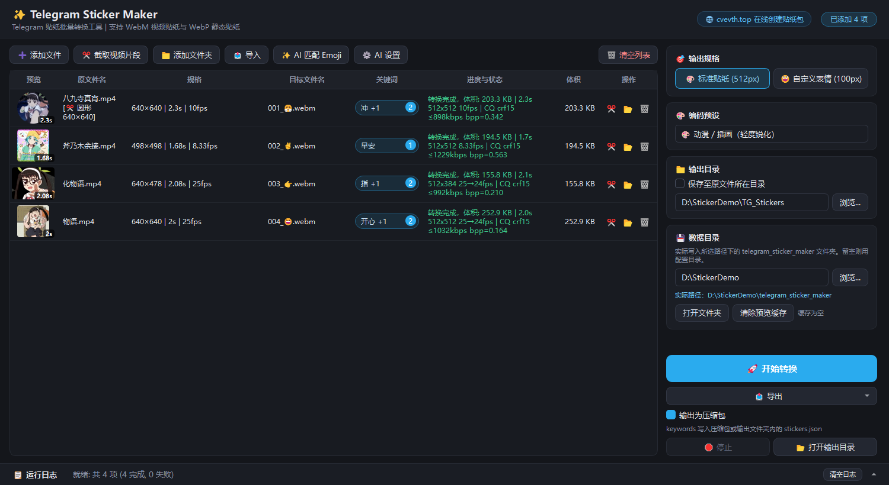
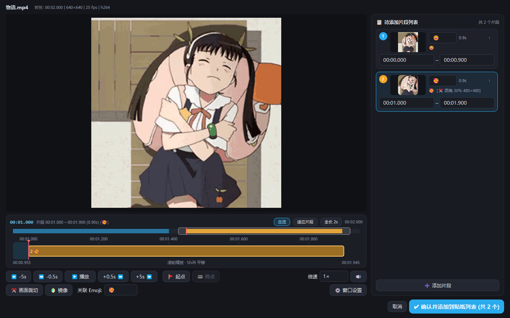
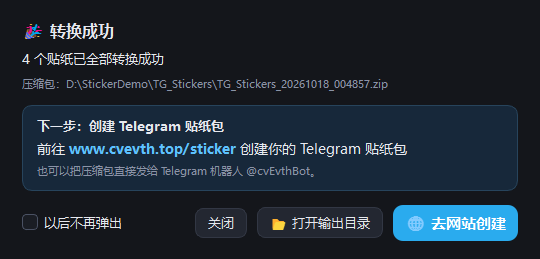

  

<h1 align="center">Telegram Sticker Maker</h1>

  <b>简体中文</b> · <a href="README.en.md">English</a> · <a href="README.ru.md">Русский</a>

  把视频、动图、图片批量做成 Telegram 贴纸的 Windows 桌面工具 
  截取片段、裁切画面、配好 Emoji 和关键词，一键转换成符合官方规格的 WebM / WebP 贴纸

  
  
  

  <a href="https://github.com/cvEvth/telegram-sticker-maker/releases/latest"><b>⬇️ 下载最新版</b></a>
  ·
  <a href="https://www.cvevth.top/sticker"><b>🌐 在线创建贴纸包</b></a>

## 功能

- **一键符合 Telegram 规格**：视频和动图转成 WebM（VP9）视频贴纸，图片转成 WebP 静态贴纸；尺寸、帧率、体积自动处理，不用自己调参数
- **画质尽量高，体积一定不超限**：按时长和运动量规划码率与帧率，两遍编码；超出 256KB 自动降码率或帧率重试，偏小时上调码率把画质"填满"
- **超过 3 秒也能用**：保留全部帧，只把文件头里的时长改写为 2.99 秒，可以通过 @Stickers 机器人的时长检查
- **截取与裁切**：在时间轴上打点，从一段视频里截出多个片段；裁切框支持比例锁定、圆角、圆形和镜像；点击片段自动循环预览
- **Emoji 与关键词**：双击设置 Emoji，右键批量设置 Emoji 和关键词；也可以接入兼容 OpenAI 的视觉模型，自动识别画面情绪匹配 Emoji
- **素材格式多**：MP4、MKV、WebM、MOV、AVI、FLV、GIF、APNG、动态 WebP、PNG、JPG、WebP、BMP、TIFF、HEIC；透明视频、透明 GIF / PNG 都会保留透明
- **自定义表情**：切换到 100×100 模式，一次做好一套自定义表情（Custom Emoji）
- **不怕中断**：列表和所有编辑自动保存，关掉再打开会原样恢复；也能导出原片和参数清单，换台电脑继续编辑

## 下载安装

到 [Releases](https://github.com/cvEvth/telegram-sticker-maker/releases/latest) 下载：

| 文件 | 说明 |
|---|---|
| `TelegramStickerMaker-x.y.z-win64-setup.exe` | 安装程序，默认装到当前用户，不需要管理员权限 |
| `TelegramStickerMaker-x.y.z-win64.zip` | 便携版，解压后双击 `TelegramStickerMaker.exe` 即可运行 |

系统要求：Windows 10 / 11 64 位。两个包都自带运行库，不需要另外安装任何东西。

## 快速上手

1. 把视频、动图或图片**拖进窗口**，也可以点「添加文件」「添加文件夹」
2. 需要截取片段或裁切画面时，点每一行的 ✂️ 打开编辑窗口
3. **双击「目标文件名」**设置 Emoji；右键菜单可以批量设置 Emoji、关键词，或让 AI 匹配 Emoji
4. 点「🚀 开始转换」，完成后会在输出目录生成 `TG_Stickers_日期_时间.zip`（贴纸 + 记录 Emoji 和关键词的 `stickers.json`）

### 截取与裁切

一段视频可以截出多个片段，每个片段都有自己的起止时间、裁切框、圆角、镜像和 Emoji。点片段卡片或时间轴上的色块会在片段内循环播放，`[` / `]` 打起点和终点，`空格`播放暂停。

### 创建贴纸包

转换完成后，前往 **[www.cvevth.top/sticker](https://www.cvevth.top/sticker)** 创建你的 Telegram 贴纸包，也可以把压缩包直接发给 Telegram 机器人 **@cvEvthBot**。

## Telegram 贴纸规格

工具会自动按下面的官方要求输出：

| 类型 | 尺寸 | 格式 | 体积上限 |
|---|---|---|---|
| 视频贴纸 | 长边 512px | WebM（VP9），无音轨，≤ 3 秒 | 256 KB |
| 静态贴纸 | 长边 512px | WebP，可透明 | 512 KB |
| 自定义表情 | 100×100 | 视频 WebM / 静态 WebP | 64 KB |

## 常见问题

<b>打开时 Windows 提示"已保护你的电脑"</b>

程序没有购买代码签名证书，Windows SmartScreen 会提示"未知发布者"。点「更多信息」→「仍要运行」即可。每个版本都在 Release 说明里附了 SHA-256，可以核对下载的文件。

<b>AI 匹配 Emoji 怎么用</b>

点工具栏的「⚙️ AI 设置」，填写 API Key、Base URL 和模型名称。支持任何兼容 OpenAI Chat Completions 格式的视觉模型（如 OpenAI、DeepSeek、Moonshot、OneAPI 等中转）。Base URL 指向本机（localhost / 127.0.0.1）时可以不填 Key。识别时只看最终贴纸区域（已应用裁切、圆角、镜像），视频会取几帧拼成一张图。

<b>转换失败或提示体积超限</b>

画面复杂、运动剧烈的长片段即使降到最低帧率也可能压不进 256KB。可以截短一点、裁掉多余的画面；如果「编码预设」选的是「⚡ 快速导出」，换回默认的「✨ 高画质」（两遍编码加轻度降噪，同样体积画质更好）。失败原因会写在状态栏和运行日志里。

<b>设置和缓存保存在哪里</b>

默认在 `%LOCALAPPDATA%\TelegramStickerMaker`（设置、自动保存的列表、预览缓存）。可以在右侧「数据目录」里改到别的盘，「清除预览缓存」可以释放空间。卸载程序时会保留这些数据，重新安装后可以继续使用。

## 开发

C++20 · Qt 6.8 · FFmpeg 8.1 · libwebp · libzip · CMake + vcpkg。构建、测试、打包和发版流程见 [docs/development.md](docs/development.md)，版本改动见 [CHANGELOG.md](CHANGELOG.md)。

## 致谢

本程序使用了 [Qt](https://www.qt.io/)（LGPL v3）、[FFmpeg](https://ffmpeg.org/)（LGPL）、[libwebp](https://chromium.googlesource.com/webm/libwebp)、[libzip](https://libzip.org/) 等开源组件，许可证随安装包附带，见 `THIRD_PARTY_NOTICES.txt`。
